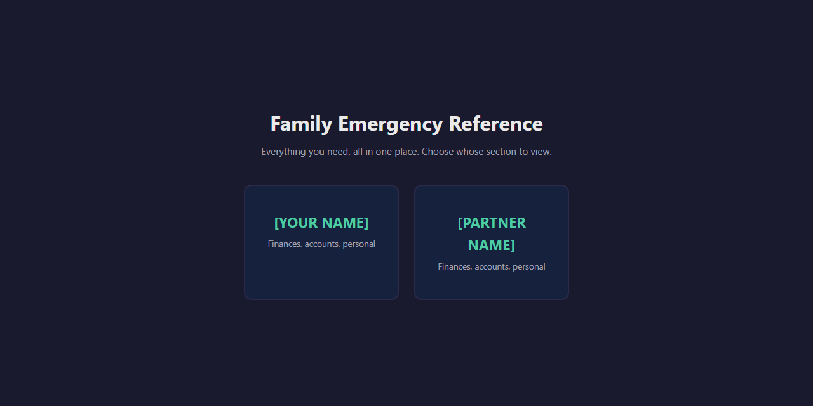
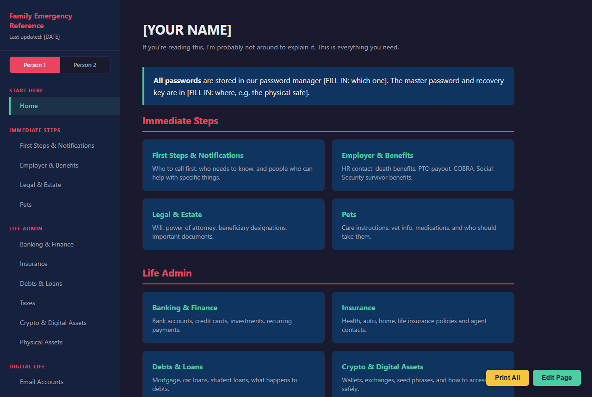
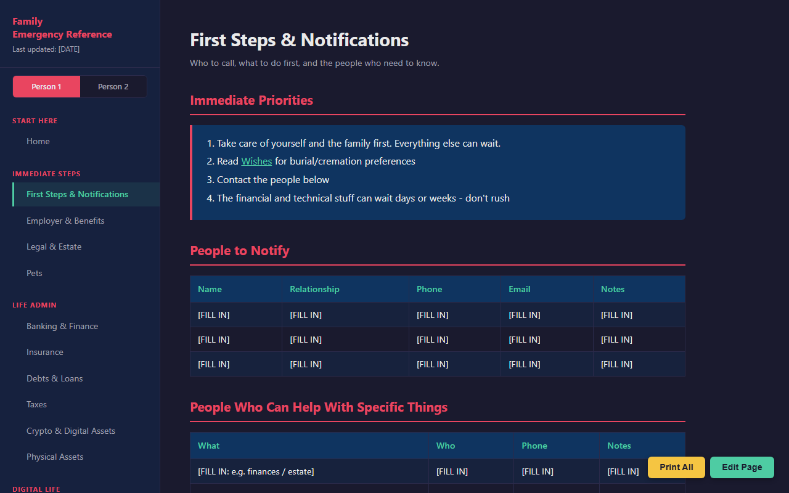

# Family Reference (template)

A simple, editable "if something happens to me" reference site. It is plain HTML pages plus a
tiny Python (Flask) server that adds an Edit/Save button to every page and a Print All view.
It runs fully offline: the editor is bundled, nothing is loaded from the internet.

No Docker needed. This guide installs it directly on a Raspberry Pi.

## Screenshots

| Pick a person | Home page |
|---|---|
|  |  |

| Notify list | Legal and estate |
|---|---|
|  |  |

Every page has an **Edit Page** button (type directly in the browser, then Save) and a
**Print All** button that builds one printable document per person.

## What is in the folder
- `wiki/` - the site itself (HTML, CSS, bundled editor). Your edits are saved here.
- `server.py` - the small Python (Flask) web server
- `family-ref.service` - lets the Pi start the site automatically on boot
- `requirements.txt` - only needed if you use pip instead of apt

## Install on a Raspberry Pi (no Docker)

These steps work on Raspberry Pi OS (Bookworm or newer) and other Debian-based systems.
You need internet for step 2 only. After that the Pi can be fully offline.

### 1. Copy the folder to the Pi
On the Pi, if it has internet, the easiest way is:

    sudo apt install git
    git clone https://github.com/jlaprade-git/family-reference-template.git ~/family-ref

Or click **Code, Download ZIP** on the GitHub page and unzip it (the folder will be named
`family-reference-template-main`; rename it to `family-ref` so the paths below match).

Offline options (no internet on the Pi):

Put the unzipped folder at `/home/<your-username>/family-ref`. Any of these works:
- USB stick: copy the folder over and move it with the file manager or `cp -r`.
- From another computer on the network:
  `scp -r family-ref <your-username>@<pi-ip>:/home/<your-username>/`
- Or copy the zip over, then on the Pi: `unzip FamilyRef-template.zip -d ~/family-ref`
  (run `sudo apt install unzip` first if needed).

Not sure of your username? Run `whoami` on the Pi.

### 2. Install Flask (one time, needs internet)
    sudo apt update
    sudo apt install python3-flask

Use apt rather than pip. Newer Raspberry Pi OS blocks `pip install` system-wide.

### 3. Try it
    cd ~/family-ref
    python3 server.py

Find the Pi's address with `hostname -I` (the first number, like `192.168.1.50`). From any
computer or phone on the same network, open `http://192.168.1.50:8080` (use your own number).
On the Pi itself you can use `http://localhost:8080`.

Press Ctrl+C in the terminal to stop it.

### 4. Make it start on boot
Open `family-ref.service` in a text editor and change the three places that say `pi` or
`/home/pi/family-ref` to your username and folder. Then:

    sudo cp ~/family-ref/family-ref.service /etc/systemd/system/
    sudo systemctl daemon-reload
    sudo systemctl enable --now family-ref

Check that it is running:

    systemctl status family-ref

Now it starts by itself every time the Pi boots.

### 5. Fill it in
Open the site, go to a page, and click **Edit Page** (bottom right). Change the text, then
click **Save**. Replace every `[FILL IN]`, `[YOUR NAME]`, `[PARTNER NAME]` and `[DATE]`.
Do not type actual passwords or crypto seed phrases into the site. Write down where they are
kept instead (for example "in the safe" or "in my password manager").

Click **Print All** to get one combined page per person. Use "Save as PDF" or print a paper
copy and keep it somewhere the family can find it.

## Settings (optional)
Set these in the `Environment=` lines of `family-ref.service`, or before the command when
running by hand:

| Variable    | Default      | What it does                                          |
|-------------|--------------|-------------------------------------------------------|
| `WIKI_PORT` | `8080`       | Port to listen on                                     |
| `WIKI_HOST` | `0.0.0.0`    | `127.0.0.1` = only the Pi itself can open it          |
| `WIKI_DIR`  | `./wiki`     | Where the site files live                             |

After changing the service file: `sudo systemctl daemon-reload && sudo systemctl restart family-ref`

## Security
There is no login. Anyone who can reach the page can read and edit it, and it will contain
sensitive information. Keep the Pi on a private home network. Never port-forward it or put it
on the internet. If you only want to use it on the Pi itself, set `WIKI_HOST=127.0.0.1`.

## Backups
Everything you write lives in the `wiki/` folder. Copy that folder to a USB stick or another
computer now and then. Printing the PDF is a good second backup.

## Troubleshooting
- **Page will not load from another computer:** check both are on the same network, confirm
  the IP with `hostname -I`, and make sure the service is running (`systemctl status family-ref`).
- **`ModuleNotFoundError: No module named 'flask'`:** run `sudo apt install python3-flask`.
- **"Address already in use":** something else uses port 8080. Set a different `WIKI_PORT`.
- **Service fails to start:** read the log with `journalctl -u family-ref -n 30`. Usually the
  username or folder path in `family-ref.service` is wrong.
- **Edit button does nothing:** make sure `wiki/vendor/tinymce` was copied along with the rest.
- **Address changes after a reboot:** give the Pi a fixed address in your router settings
  (a "DHCP reservation"), so the link you bookmark keeps working.
